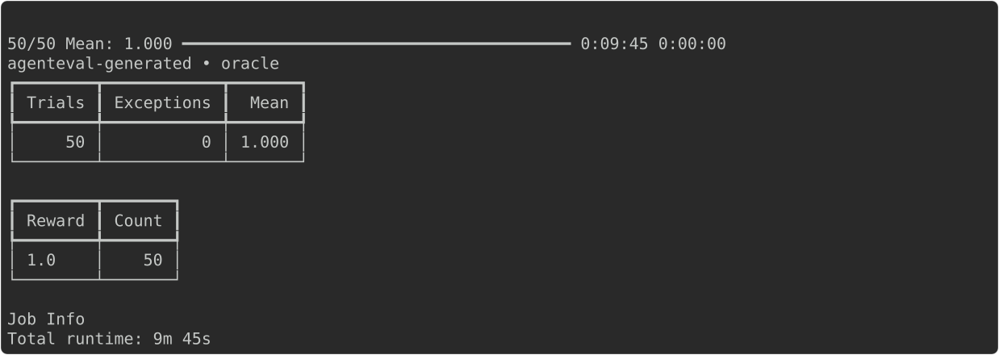

# AgentEval Games → Harbor Adapter

## Overview

This adapter converts the complete **Maze test split (25 tasks)** and **Wordle test
split (25 tasks)** from AgentGym's AgentEval dataset into 50 interactive Harbor
tasks. These are two selected splits, not the full AgentGym suite. The adapter
preserves the published test IDs, original instructions, seeded game behavior,
action parsing, and final-step reward.

All 50 reference solutions passed through the real Harbor/Docker harness with
zero exceptions, graded by a separate verifier on Harbor 0.27.0. Parity ran on
all 50 tasks with three runs per side: 100.00 ± 0.00 on the original side and
100.00 ± 0.00 on Harbor (see the parity section for how the model was called
and why the scores are supplemented with a replay check).

## What is AgentEval Games?

[AgentGym](https://github.com/WooooDyy/AgentGym) evaluates agents across interactive
environments. Its [AgentEval dataset](https://huggingface.co/datasets/AgentGym/AgentEval)
provides the two 25-item test lists used here. Maze tasks navigate a fixed double-T
maze from different starting positions. Wordle tasks play LMRL-Gym's 40-word,
six-attempt candidate-state game, with a distinct random seed per test item.

The score is the original **last-step reward**, averaged across episodes: 1 for
success, 0 otherwise. Maze allows 15 model turns in AgentGym's published test
runner; Wordle has an eight-turn evaluator limit and terminates internally after
at most six guesses.

## Adapter Features

- Offline generation from pinned, bundled test lists, prompts, vocabulary, and
  licensed game sources. Stable IDs are `agentgym/agenteval-maze-00` through `-24`
  and `agentgym/agenteval-wordle-00` through `-24`.
- An isolated game sidecar holds the seed, authoritative state, and trajectory.
  The agent container receives only the terminal `game` client. Every submitted
  action, including an invalid action, consumes an original benchmark turn.
- Grading runs in a **separate verifier environment** built from
  `tests/Dockerfile`, never in the agent's container. The sidecar records the
  authoritative transcript on its own filesystem. After the agent phase Harbor
  stops the agent container, collects the transcript directly from the sidecar,
  and the verifier replays every action against its own copy of the benchmark
  code. The agent container shares no volume with the sidecar or the verifier,
  so workspace files, forged rewards or transcripts, rewritten clients, and
  forged HTTP responses cannot change the graded episode.
- Maze reference solutions use shortest paths. Wordle reference solutions use
  the first remaining vocabulary candidate and update candidates from public
  feedback. They do not require access to the next random target.
- The terminal transport supports standard Harbor agents. A native conversation
  agent and original-side runner preserve AgentGym's user/assistant initialization
  and action/observation dialogue for model parity.

## Generated Task Structure

```text
agenteval-maze-00/
├── task.toml
├── instruction.md
├── environment/
│   ├── Dockerfile                 # agent client only
│   ├── Dockerfile.game            # private game sidecar
│   ├── docker-compose.yaml
│   ├── game.py
│   ├── config.json
│   ├── runtime/
│   └── data/
├── solution/
│   ├── solve.sh
│   ├── solve.py
│   └── actions.json
└── tests/
    ├── Dockerfile                 # separate verifier image
    ├── test.sh
    ├── verify.py
    ├── config.json
    ├── runtime/
    └── data/
```

Only the files explicitly copied by `environment/Dockerfile` enter the agent
image. The game configuration and game implementation enter the separate sidecar.
Harbor supplies `solution/` to oracle trials. `tests/` is the build context of
the verifier image; it is never uploaded into the agent container.

`task.toml` sets `[verifier].environment_mode = "separate"` and declares one
artifact, `{ source = "/game-evidence/transcript.json", service = "game" }`.
That file is the only input the verifier takes from a trial, and Harbor keeps a
copy at `artifacts/game-evidence/transcript.json` in the trial directory.

## Run Evaluation / Harness

Registry evaluation becomes available once the Harbor team publishes the dataset
([dataset PR](https://github.com/harbor-framework/harbor-datasets/pull/290)). The
registry name is `agentgym/agenteval-games`, with the requested tag `v1.0`:

```bash
harbor run -d agentgym/agenteval-games -a oracle
```

For local oracle verification, from the adapters repository root:

```bash
harbor run -p /tmp/agenteval-games -a oracle --n-concurrent 4
```

Or generate into `datasets/agenteval-games` and use the checked-in reference config:

```bash
harbor run -c src/agenteval-games/run_agenteval-games.yaml
```

On November 21, 2026, the full oracle run completed **50/50 tasks with reward 1**
(mean 1.000, zero exceptions, zero retries) in 9 minutes 45 seconds on Harbor
0.27.0, with every trial graded in the separate verifier environment. Two
negative controls on one task from each game returned **0 on both**: a
no-action agent, and a known-wrong submission that loses the real episode and
then plants a winning transcript and reward files inside the agent container.
See [full oracle results](validation/harbor-oracle.json),
[no-action controls](validation/harbor-nop-smoke.json),
[wrong-submission controls](validation/harbor-wrong-submission.json), and the
[captured terminal output](validation/oracle-terminal.txt).



Each task requires Docker Compose because the private game service must remain
outside the agent container, and a Harbor release that supports separate
verifiers and per-service (`service = ...`) artifact collection. The tasks are
validated on Harbor 0.27.0 with the local Docker backend; single-container and
cloud backends have not been validated. A task does not require a GPU or a
model-based judge.

## Usage: Create Task Directories

```bash
cd src/agenteval-games
uv sync --locked
uv run agenteval-games --output-dir /tmp/agenteval-games
```

The full default emits exactly 50 tasks. Generate one split or a small subset with:

```bash
uv run agenteval-games --output-dir /tmp/agenteval-wordle --split wordle
uv run agenteval-games --output-dir /tmp/agenteval-smoke --task-ids agenteval-maze-00 agenteval-wordle-00
uv run agenteval-games --output-dir /tmp/agenteval-smoke --task-ids lmrlgym_maze_0 lmrlgym_wordle_0 --overwrite
uv run agenteval-games --output-dir /tmp/agenteval-first --limit 2
```

`--task-ids` accepts registry-safe names, namespaced names, or upstream item IDs.
Unknown IDs fail before any task is written. Existing selected task directories
require `--overwrite`. Generation preserves the upstream order, so `--limit 2`
selects the first two Maze tasks rather than a balanced sample.

## Comparison with Original Benchmark (Parity)

Parity ran on **all 50 tasks with three full runs per side**. Both sides scored
100% in every run, so the run-score ranges overlap.

| Agent | Model | Metric | Runs | Dataset Size | Original (mean ± SEM) | Harbor (mean ± SEM) |
|-------|-------|--------|------|--------------|-----------------------|---------------------|
| agenteval-native@0.1.0 | gpt-6.1-astra | final-step reward (%) | 3 | 50 (100%) | 100.00 ± 0.00 | 100.00 ± 0.00 |

Per game, both sides scored 100.00 ± 0.00 on Maze (25 tasks) and on Wordle (25
tasks). The raw run scores are in `parity_experiment.json`; the per-game
breakdown is in [validation/parity-compare.json](validation/parity-compare.json).

**What was compared.** AgentGym drives a chat model through its own conversation
loop and has no Harbor-compatible CLI agent, so this is a custom-agent parity.
One conversation policy, `agenteval_games.native_policy`, runs on both sides: as
`AgentEvalNativeAgent` on Harbor 0.27.0, and as `agenteval_games.original_runner`
against the unmodified upstream `lmrlgym` server. Both send the original role
message, acknowledgement and observations, with no transport instructions. The
runs followed the required order: a sanity check on 5 Maze and 5 Wordle tasks
per side (10/10 on both; that check ran on Harbor 0.26.0, the full runs on
0.27.0), one full run per side, then two more per side.

**How the model was called.** `gpt-6.1-astra` was reachable only through the
Codex CLI (codex-cli 0.171.0) on a private gateway. Both sides therefore sent
their chat requests to `scripts/codex_chat_bridge.py`, which answers each
request with one `codex exec` call at reasoning effort `medium`. The following
applies equally to both sides:

- Codex's own system prompt and a short instruction to reply as the assistant
  precede the conversation.
- `temperature`, `max_tokens` and `top_p` cannot be set on this route, so the
  runs omit them.
- The model ID is not a dated identifier. The gateway serves the model under an
  internal alias, which the uploaded logs show as `<gateway-model-alias>`.
- Codex had no built-in metadata for the gateway's name for this model and ran
  with its fallback model settings.
- The six runs made 1,537 model calls with no failures, and Codex executed no
  commands in any of them. They used 32.5M input and 0.07M output tokens.

These scores are therefore not comparable to published AgentGym results, which
were obtained through a plain chat API.

**Scores at the ceiling.** Matching 100% scores satisfy the range-overlap rule
but cannot by themselves reveal a small divergence. As a model-free supplement,
`scripts/cross_replay.py` replayed every reply recorded on the original side
through this adapter's game engine, and every reply recorded on the Harbor side
through the upstream server. Across 300 episodes and 1,537 steps, every
observation, reward and termination flag matched
([validation/parity-cross-replay.json](validation/parity-cross-replay.json)).
The replays are less varied than their count suggests: in Maze the model took
the same path in all six runs of every task (25 distinct action sequences),
while its Wordle guesses varied (56 distinct sequences over the 25 tasks).
Invalid, exhausted and truncated episodes, which this model never produced, are
covered by the deterministic comparison below.

**Standard agent.** To show that the tasks work with a standard CLI agent,
Harbor's built-in `codex@0.171.0` played all 50 tasks once with the same model
through the terminal `game` client and scored 50/50 at reward 1.0, with no
errors or retries. This run is on the Harbor side only and is not a parity
comparison.

Links: [original benchmark](https://github.com/WooooDyy/AgentGym/tree/3ef9235d23e68e7c2920c5422ad957dc8ced5c6c)
(no fork; the original-side runner is part of this adapter),
[adapter PR](https://github.com/harbor-index/adapters/pull/20),
[dataset PR](https://github.com/harbor-framework/harbor-datasets/pull/290),
[parity artifacts PR](https://huggingface.co/datasets/harborframework/parity-experiments/discussions/296).
That Hugging Face repository currently rejects new files because it is over the
Hub's file-count limit, so the artifacts are mirrored at
[zodi1121/agenteval-games-parity-experiments](https://huggingface.co/datasets/zodi1121/agenteval-games-parity-experiments)
until they can be pushed to the PR.

Run deterministic checks without model API calls:

```bash
# Lightweight checks; optional Harbor/upstream integration checks may be skipped.
uv run python -m unittest discover -s tests -v
# All 28 tests, with the pinned Harbor environment and upstream checkout available.
AGENTEVAL_UPSTREAM_DIR=/path/to/AgentGym /tmp/agenteval-harbor/bin/python -m unittest discover -s tests -v
# Independent, pinned Python 3.9.12 comparison with the original implementation.
bash scripts/run_upstream_check.sh
# Actual Harbor + Docker, but a local deterministic mock model (no API charges).
uv run python scripts/check_native_harbor.py \
  --harbor /tmp/agenteval-harbor/bin/harbor --dataset-dir /tmp/agenteval-games \
  --jobs-dir /tmp/agenteval-harbor-jobs --job-name native-smoke-01
# The same mock model through the original-side runner and the real upstream
# server (start that server first; see the original-side instructions below).
uv run python scripts/check_native_original.py \
  --upstream-dir /path/to/AgentGym --environment-base-url http://127.0.0.1:36001 \
  --dataset-dir /tmp/agenteval-games --output-dir /tmp/agenteval-original-smoke \
  --run-name original-native-smoke-01
```

The complete unit/integration suite passed **28/28 with no skips**. A separate
real Harbor/Docker smoke test also exercised the native agent on one Maze and one
Wordle task using a **local mock model endpoint**, achieving 2/2 successful
reference episodes with no exceptions ([results](validation/harbor-native-smoke.json)).
This validates native-agent wiring and
failure recording, not a model's capability or model parity. The smoke script
requires a fresh job name and records its configuration, mock requests, and
assertion result beside the Harbor job directory.

The original-side counterpart drove the same two tasks through
`agenteval_games.original_runner` against the unmodified upstream `lmrlgym`
server with the same mock endpoint and reference actions, also achieving 2/2
([results](validation/original-native-smoke.json)). Both sides issued the same
15 model requests. Like the Harbor check, this shows wiring only.

The independent checker loads the pinned original game implementations and
AgentGym wrappers, compares initial prompts and step responses, and exercises
successful, invalid, exhausted, repeated-letter, parsing, and truncated episodes.
It passed **350 scenarios and 3,280 state comparisons across all 50 tasks**,
including 50/50 original-engine reference solutions. The machine-readable result
is in [validation/differential.json](validation/differential.json).

To reproduce the parity runs, install the adapter in the same Python environment
as Harbor. Start the model endpoint that both sides use; it needs a Codex CLI
login that can reach the model (`--profile` selects a Codex profile):

```bash
python scripts/codex_chat_bridge.py --effort medium --port 18080 --concurrency 6 \
  --log /tmp/agenteval-parity/bridge-calls.jsonl
# The bridge ignores the key, but the policy requires a non-empty one.
export AGENTEVAL_BRIDGE_KEY=unused-local-bridge
```

Harbor side, with the settings in `parity_agenteval-games.yaml`:

```bash
/tmp/agenteval-harbor/bin/harbor run -c parity_agenteval-games.yaml \
  -o /tmp/agenteval-parity/jobs --job-name harbor-run1
```

For the original side, check out AgentGym at the commit below, initialize its
pinned LMRL-Gym submodule, and start the unmodified upstream `lmrlgym` server
from a Python 3.9.12 environment. `scripts/Dockerfile.original` builds one:

```bash
git clone https://github.com/WooooDyy/AgentGym.git /path/to/AgentGym
git -C /path/to/AgentGym checkout --detach 3ef9235d23e68e7c2920c5422ad957dc8ced5c6c
git -C /path/to/AgentGym submodule update --init agentenv-lmrlgym/lmrlgym
docker build -f scripts/Dockerfile.original -t agenteval-original-server \
  /path/to/AgentGym/agentenv-lmrlgym
docker run --rm -p 127.0.0.1:36001:36001 agenteval-original-server
```

The upstream
[setup instructions](https://github.com/WooooDyy/AgentGym/blob/3ef9235d23e68e7c2920c5422ad957dc8ced5c6c/agentenv-lmrlgym/README.md)
no longer install as written: `lmrlgym/requirements.txt` pins `jaxlib==0.4.7`,
which PyPI has stopped serving, and its unpinned transitive dependencies now
resolve to releases without Python 3.9 support. The image therefore installs
only the packages the Maze and Wordle servers import, at upstream's pins where
it has them, and copies the upstream sources unchanged. The complete
requirements file can still be installed on x86-64 by adding
`-f https://storage.googleapis.com/jax-releases/jax_releases.html` and
constraining `spacy<3.8`, but that `jaxlib` build needs AVX and does not run
under x86 emulation on Apple Silicon. Then run the shared native policy from
this adapter:

```bash
uv run python -m agenteval_games.original_runner \
  --upstream-dir /path/to/AgentGym \
  --environment-base-url http://127.0.0.1:36001 \
  --model gpt-6.1-astra \
  --temperature none --max-tokens none --top-p none \
  --request-timeout-sec 120 --environment-timeout-sec 30 --episode-timeout-sec 1500 \
  --api-base http://127.0.0.1:18080/v1 --api-key-env AGENTEVAL_BRIDGE_KEY \
  --run-id 1 --output-json /tmp/agenteval-parity/original-run1.json
```

Repeat both sides with new run names, then compare the runs and replay each
side's replies through the other environment:

```bash
uv run python scripts/parity_compare.py \
  --original /tmp/agenteval-parity/original-run{1,2,3}.json \
  --harbor /tmp/agenteval-parity/jobs/harbor-run{1,2,3}
uv run python scripts/cross_replay.py \
  --original /tmp/agenteval-parity/original-run{1,2,3}.json \
  --harbor /tmp/agenteval-parity/jobs/harbor-run{1,2,3} \
  --environment-base-url http://127.0.0.1:36001
```

A model with a plain OpenAI-compatible Chat Completions endpoint needs no bridge:
point `api_base` (or `OPENAI_BASE_URL`) and the key variable at it. Some models
reject one of the default request fields. Set `temperature`, `max_tokens` or
`top_p` to `null` (`none` on the original-side command line) to leave that field
out of the request, and pass provider-specific fields such as
`max_completion_tokens` through `extra_body` (`--extra-body` with a JSON
object). The same shared code builds the request on both sides, and each report
records the effective settings.

Use `--task-ids` with the same selected IDs on both sides for sanity checks. The
original runner verifies the local source commits and prompts, but the operator
must ensure that the HTTP server was actually launched from that checkout. It
does not replay the adapter engine as the original side. Both runners log model
requests and responses, effective settings, usage, and failures; uncertain HTTP
steps are not retried or silently scored as losses. The shared policy also
imposes an explicit episode deadline (1,500 seconds in the parity runs, within
Harbor's 1,800-second agent timeout). Unlike upstream APIAgent's unbounded error
retries, errors and deadline expiration stop the run without a score. This
policy is identical on both sides.

## Notes & Caveats

- **Wordle is adaptive, not standard fixed-target Wordle.** Each valid guess draws
  a new word from the current candidate set using the seeded RNG. Invalid guesses
  consume an attempt but not a random draw. Repeated letters use the upstream
  per-character position rules rather than conventional Wordle multiplicities.
  The original prompt is retained even though it describes a hidden word.
- The original `</s>` handling removes five characters although the suffix is
  four characters long. This adapter preserves that behavior, case sensitivity,
  the first `Action:` segment, and ASCII-space-only Wordle normalization. It does
  not silently fix upstream behavior.
- Maze's original engine supports 50 internal steps, but the published AgentGym
  **test evaluation stage** applies 15 turns. The adapter uses that cap and keeps
  the original `done` flag separate from adapter `episode_finished` truncation.
  Wordle's six-guess internal limit takes precedence over its eight-turn cap.
- The terminal adapter adds commands and public transport metadata to make the
  task usable by shell agents. These transport instructions are not a claim of
  prompt parity with the original native conversation. Native parity uses the
  original role messages and observation text, without transport instructions.
- Source/runtime pins: AgentGym `3ef9235d23e68e7c2920c5422ad957dc8ced5c6c`,
  LMRL-Gym `83abeedb3a461c3d7d20572b73318a259d85f2ac`, AgentEval
  `1f090d52ef01a83a889da02699e34a500e35a274`, Python **3.9.12** for the game
  sidecar and verifier, and Harbor **0.27.0**. All three task images are
  digest-pinned. Adapter generation uses Python 3.11+.
- The agent image only carries the `game` client, so it does not use the
  benchmark's Python. It is based on Debian 12 (`python:3.12-slim-bookworm`)
  because Harbor's installed agents set themselves up with `apt-get`, which
  fails on the end-of-life Debian 11 base of the Python 3.9.12 image.
- Exclusions: all other AgentGym environments, their training splits, and any
  expanded/randomized Maze or Wordle instances. The two selected test splits
  themselves are complete; no task was dropped or sampled.
- The Wordle core is vendored with only its `Cache` import made relative. Maze's
  fixed-map transition and observation logic are extracted to remove unrelated
  training, JAX, and image-generation dependencies; differential checks cover
  their reachable behavior under the 15-turn test protocol.
- Original AgentGym and LMRL-Gym MIT notices are included. AgentEval's pinned
  dataset has no separate license declaration in its card; the adapter records
  that provenance without assigning it an invented dataset license.
- The grading boundary is Harbor's separate verifier plus Docker's container
  separation: the agent container reaches the sidecar only through its HTTP API
  and shares no volume with it, and Harbor reads the transcript from the
  sidecar itself. The transcript is not cryptographically signed, because its
  authenticity comes from that collection path rather than from anything the
  agent container handles. A compromised container runtime or Harbor host is
  outside this boundary.
- Parity limitations: the parity model was called through the Codex CLI, with
  Codex's system prompt and without settable sampling parameters, under a model
  ID that is not a dated identifier and through a private gateway that reviewers
  cannot use. Both sides scored 100%, so parity rests on equal scores at the
  ceiling plus the model-free replay check described in the parity section. A
  weaker model with a plain chat endpoint would give a more discriminating
  comparison and can be run with the same commands.

## Installation / Prerequisites

The generator requires Python 3.11+ and `uv`; evaluation additionally requires
Docker with Compose and the external Harbor CLI. To reproduce the compatibility
baseline in a separate environment:

```bash
uv venv --python 3.12 /tmp/agenteval-harbor
uv pip install --python /tmp/agenteval-harbor/bin/python 'harbor==0.27.0'
uv pip install --python /tmp/agenteval-harbor/bin/python -e .
/tmp/agenteval-harbor/bin/harbor --version
```

Run these commands from `src/agenteval-games`. Task generation needs no network
access after dependencies are installed. Docker image builds need access to the
pinned Python image; the sidecar and verifier images also install one pinned
Python package. Standard Harbor agents install
their own CLI prerequisites and need their usual model credentials; oracle and
deterministic checks do not use model credentials.

## Troubleshooting

- **Episode already finished:** create a new Harbor trial. There is deliberately no
  reset endpoint that would let an agent retry the same hidden episode.
- **Invalid Wordle guess:** use one of the 40 supplied lowercase vocabulary words.
  Invalid guesses still count toward the six-attempt limit.
- **Reward stays zero:** inspect `artifacts/game-evidence/transcript.json` in the
  trial directory and the original step observations. A final answer file or
  edited local score is not evaluated.
- **Transcript is missing or replay fails:** check the `game` entry in
  `artifacts/manifest.json` and `verifier/test-stdout.txt`. Do not switch the
  verifier to shared mode or accept a transcript from the agent container as a
  workaround.
- **Game host is unavailable:** run with the Docker backend and check the game
  sidecar health. The terminal client uses the Compose service name `game`.
- **A parity run stops with a protocol error:** model or environment errors are
  never scored as losses. Fix the cause and repeat the run under a new run name.

## Citation

```bibtex
@misc{xi2024agentgym,
  title={AgentGym: Evolving Large Language Model-based Agents across Diverse Environments},
  author={Zhiheng Xi and Yiwen Ding and Wenxiang Chen and Boyang Hong and Honglin Guo and Junzhe Wang and Dingwen Yang and Chenyang Liao and Xin Guo and Wei He and Songyang Gao and Lu Chen and Rui Zheng and Yicheng Zou and Tao Gui and Qi Zhang and Xipeng Qiu and Xuanjing Huang and Zuxuan Wu and Yu-Gang Jiang},
  year={2024},
  eprint={2406.04151},
  archivePrefix={arXiv},
  primaryClass={cs.AI}
}
```

## Authors & Contributions

AgentGym and AgentEval: Zhiheng Xi, Yiwen Ding, Wenxiang Chen, and the AgentGym
contributors. The underlying LMRL-Gym environments are credited to Charlie Snell
and the LMRL-Gym contributors, with their MIT notice retained.

Harbor adapter: Zonglin DI ([ElegantLin](https://github.com/ElegantLin)).
