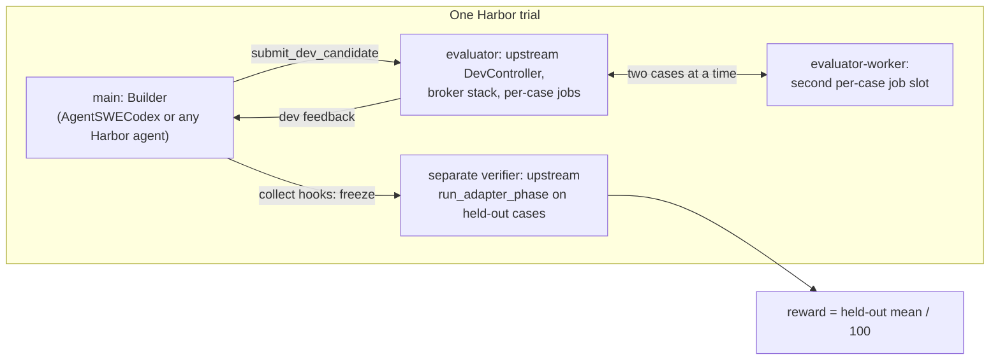

## AgentSWE → Harbor Adapter

## Overview

AgentSWE evaluates coding agents as *agent builders*: a Builder (a code-agent harness plus model) receives a
natural-language requirement and a few public example cases, develops a task-specific agent in one long session with
authoritative development feedback, and the frozen agent it delivers is then run on held-out cases that cover the
rest of the requirement. Scores come from deterministic gates plus a requirement-derived rubric applied by an LLM
judge (0–100 per case; a run's score is the mean over its held-out cases).

- **Source:** [VectorSpaceLab/AgentSWE](https://github.com/VectorSpaceLab/AgentSWE) at commit
  [`6643c739`](https://github.com/VectorSpaceLab/AgentSWE/tree/6643c7398b2d7dd58b32b6a3a829e564ab68a23f)
  (Apache-2.0), paper [arXiv:2610.13361](https://arxiv.org/abs/2610.13361).
- **Upstream size:** 25 tasks in three families: Creation (10), Editing (10) and Optimization (5). AgentSWE-Lite is an
  8-task subset (Creation `repo`, `db`, `pdf`; Editing `deeptutor`, `aider`, `openwiki`; Optimization `tau3`,
  `pinch`).
- **This adapter:** one Harbor task per AgentSWE task. This release adapts four Creation tasks: the three Creation
  tasks of AgentSWE-Lite, `repository-bug-repair` (`repo`), `database-analytics` (`db`) and
  `scientific-pdf-translation` (`pdf`), plus `evidence-grounded-document-qa` (`qa`). [Task coverage](#task-coverage)
  lists all 25 tasks with what upstream's evaluation of each one requires.
- **Main adaptation:** upstream runs every task through Harbor, orchestrated by a host-side controller that starts up
  to 23 Harbor jobs per task. Here that controller runs inside the task, unchanged: upstream's `one_stop.py` and each
  task's own `adapter.py` drive the dev rounds in an `evaluator` sidecar and the held-out evaluation in a separate
  verifier, and the per-case jobs they launch run as local processes. A task is one Harbor trial. Prompts, cases,
  rubrics, harnesses and scoring scripts are the upstream files at the pinned commit.

## What is AgentSWE?

AgentSWE (*Can Coding Agents Build the Agent You Actually Want?*) measures whether a coding agent can deliver an agent
that actually satisfies a requirement, not just one that passes the examples it was shown. Each task is a commission:
the Builder gets the requirement documents and two public development cases, may submit its candidate for
authoritative evaluation on those cases (up to 10 accepted submissions for Creation), and its final delivery is frozen
and run on six held-out cases. Every delivery calls the same fixed runtime model through an evaluator-owned broker,
so differences in scores come from what the Builder built (prompts, tool orchestration, state handling, output
validation). Creation tasks start from an empty workspace; Editing tasks extend real open-source agents; Optimization
tasks improve an agent's score on an existing benchmark.

## Adapter Features



- **Pinned upstream, generated tasks:** `agentswe` clones AgentSWE at the pinned commit (or uses `--upstream-dir`) and
  copies each task's upstream files into the generated task; the configuration profile (`lite-v1.1` by default) is
  applied as upstream does (overlay files replace base files).
- **Builder session:** the task's `instruction.md` is upstream's Builder prompt (`one_stop.builder_instruction`),
  byte for byte. The Builder sees `/builder-package` (requirement documents and public dev cases) and a writable
  private copy of the task's environment, and writes its agent to `/workspace/submission`. The environment paths and
  variables are the ones upstream gives its Builder container, computed with upstream's own `one_stop.builder_compose`
  and `runtime_contract.prepare_compose`.
- **Authoritative dev feedback:** `submit_dev_candidate` talks to upstream's `one_stop.DevController` in the
  `evaluator` sidecar over a socket on a shared volume (same CLI, feedback text, round limit and idempotency rules).
  Each dev round runs upstream's `one_stop.run_adapter_phase`, which drives the task's `adapter.py` exactly as on the
  host. The sidecar holds the dev cases, rubric, broker stack and provider keys; the Builder container holds none of
  them.
- **Per-case jobs as processes:** upstream's `adapter.py` stages each case as a Candidate job and an Eval job and runs
  them with `harbor run --config <job>`. Inside the task, that command (`agentswe_harbor.harbor`) runs each staged job
  as Harbor would with its oracle agent and a separate verifier: `solution/solve.sh`, then `tests/test.sh`, with every
  mount and environment variable of the job's compose files recreated for that step only, and the trial written in
  Harbor's layout for upstream's collectors. As upstream does (`n_concurrent = 2`), dev rounds run two cases at a time:
  one in the `evaluator` sidecar and one in `evaluator-worker`, a second container from the same image. Candidates run
  as an unprivileged user that cannot read the evaluator's files.
- **Freeze and held-out evaluation:** after the Builder exits, a `[[verifier.collect]]` hook calls upstream's
  `freeze_after_builder_exit` in the sidecar. The frozen delivery, the Builder's environment and the dev records are
  passed to a separate verifier (`tests/Dockerfile`, the only image with the held-out cases), which checks both
  digests and runs upstream's `run_adapter_phase` on the held-out cases. Reward = held-out mean / 100.
- **Upstream broker topology:** Candidate → evaluator broker (`runners/creation/broker_v2.py`) → runtime role broker
  (`broker/agentswe_broker`) → provider; Result judge → judge role broker → provider; Builder → builder role broker
  (`--rate-limit-policy as_503`) → provider. Only the role brokers hold provider keys.
- **Images:** built from upstream's pinned recipes (Ubuntu digest, apt snapshot, `env-builder` micromamba environments,
  `trusted-browser` bundle), all `linux/amd64`. No privileged containers and no Docker socket; `repo` adds only
  `SYS_PTRACE`, which its upstream verifier needs for `strace`.
- **Failures are not zeros:** an evaluator-side failure (provider or broker failure, missing evidence) withholds the
  score: the verifier exits without a reward, following upstream's `assert_runtime_health`.
- **Builder harness:** `agentswe.codex_agent:AgentSWECodex` is upstream's `ProviderCodex` (Codex 0.144.1 with the
  AgentSWE-Lite model catalog generated by upstream `gen_codex_config.py`) ported to Harbor 0.27.0; it subclasses the
  vendored upstream class and replaces only `run`. Any Harbor agent can be used as the Builder; the custom agent is
  what the parity experiments use.

## Generated Task Structure

```
agentswe/
├── repository-bug-repair/
│   ├── task.toml                      # agent 8 h, separate verifier, artifacts, freeze hook
│   ├── instruction.md                 # upstream Builder prompt
│   ├── environment/
│   │   ├── Dockerfile                 # Builder: task environment (private copy) + /builder-package
│   │   ├── docker-compose.yaml        # main, evaluator, evaluator-worker, shared volumes
│   │   ├── builder-package/           # requirement documents + public dev cases
│   │   ├── submit_dev_candidate       # wrapper around upstream's client
│   │   └── evaluator/                 # sidecar image: upstream controller, brokers, dev cases, rubric
│   ├── solution/
│   │   └── solve.sh                   # null delivery (no upstream reference agents exist)
│   └── tests/
│       ├── Dockerfile                 # separate verifier: held-out cases, trusted runtime, brokers
│       ├── docker-compose.yaml
│       └── test.sh                    # python3 -m agentswe_harbor.verify
├── database-analytics/
├── evidence-grounded-document-qa/
└── scientific-pdf-translation/
```

Adapter code:

```
src/agentswe/
├── README.md
├── adapter_metadata.json
├── parity_experiment.json
├── pyproject.toml
├── run_agentswe.yaml
├── run_agentswe_parity.yaml
└── src/agentswe/
    ├── adapter.py                     # AgentSWEAdapter: pin, select, render tasks
    ├── main.py                        # CLI
    ├── codex_agent.py                 # AgentSWECodex (Builder harness)
    ├── codex_builder/                 # upstream builders/codex: ProviderCodex, gen_codex_config.py, Lite catalog
    ├── runtime/
    │   ├── agentswe_harbor/           # runtime baked into the evaluator and verifier images
    │   │   ├── devserver.py           #   sidecar: brokers, upstream DevController, freeze socket
    │   │   ├── worker.py              #   evaluator-worker: the second per-case job slot
    │   │   ├── harbor.py              #   `harbor run` for upstream's per-case jobs
    │   │   ├── trial.py               #   one per-case job as processes
    │   │   ├── brokers.py             #   upstream's broker stack as processes
    │   │   ├── freeze.py, verify.py   #   collect hook, held-out evaluation
    │   │   └── settings.py
    │   └── bin/                       # harbor and docker commands for upstream's adapter.py
    └── task-template/
```

## Run Evaluation / Harness

Once the dataset is published:

```bash
harbor run -d agentswe/agentswe -a <agent> -m "<model>"
```

For development and reproduction, from the repository root after generating the tasks (see below):

```bash
# Oracle (null delivery; expected reward 0, exercises freeze, Candidate and Eval jobs)
harbor run -c src/agentswe/run_agentswe.yaml

# AgentSWE Builder harness (as in the parity experiments)
uv run --project src/agentswe --extra parity harbor run -p datasets/agentswe \
  --agent agentswe.codex_agent:AgentSWECodex -m gpt-6.1-sol \
  --ak version=0.144.1 --ak context_window=272000

# Any Harbor agent as the Builder
harbor run -p datasets/agentswe -a codex -m "<model>"
```

Provider configuration is read from the environment of the `harbor` process (Harbor asks before
loading the `[verifier.env]` values; pass `--yes` in non-interactive runs):

| Variable | Used by | Default |
|---|---|---|
| `AGENTSWE_RUNTIME_BASE_URL` / `_API_KEY` / `_MODEL` / `_EFFORT` | runtime role broker (model the delivered agent calls) | `https://api.deepseek.com/v1`, `deepseek-flash`, `high` |
| `AGENTSWE_JUDGE_BASE_URL` / `_API_KEY` / `_MODEL` / `_EFFORT` | judge role broker (Result judge) | `https://api.deepseek.com/v1`, `deepseek-flash`, `max` |
| `AGENTSWE_BUILDER_BASE_URL` / `_API_KEY` / `_MODEL` / `_EFFORT` | builder role broker (only for `AgentSWECodex`) | unset; effort `xhigh` |
| `AGENTSWE_DOCKER_REGISTRY`, `AGENTSWE_BUILD_PROXY`, `AGENTSWE_APT_MIRROR`, `AGENTSWE_CONDA_CHANNEL`, `AGENTSWE_PIP_INDEX_URL`, `AGENTSWE_NODE_DIST_URL`, `AGENTSWE_NPM_REGISTRY`, `AGENTSWE_UBUNTU_MIRROR`, `AGENTSWE_CFT_BASE_URL` | optional mirrors and proxy for image builds (upstream's build arguments) | public sources |

## Usage: Create Task Directories

```bash
cd src/agentswe
uv run agentswe --output-dir ../../datasets/agentswe
```

Available flags:
- `--output-dir` — directory to write generated tasks (default `datasets/agentswe` at the repository root)
- `--limit` — generate only the first N tasks
- `--overwrite` — overwrite existing tasks
- `--task-ids` — only generate these tasks (upstream id or short name, e.g. `repo`)
- `--split` — `full` (all adapted tasks), `lite` / `parity` (the AgentSWE-Lite tasks)
- `--profile` — upstream configuration profile (default `lite-v1.1`)
- `--upstream-dir` — use an existing AgentSWE checkout at the pinned commit instead of cloning
- `--cache-dir` — where the pinned checkout is cloned (default `~/.cache/harbor-agentswe`)

## Comparison with Original Benchmark (Parity)

Parity is in progress.

| Agent | Model | Metric | Number of Runs | Dataset Size | Original Benchmark Performance | Harbor Adapter Performance |
|-------|-------|--------|------------------|--------------|------------------------------|----------------------------|
| agentswe-codex@0.144.1 | gpt-6.1-sol | held-out mean score | pending | 3 (Creation Lite) | pending | pending |

- **Configuration (both sides):** Builder Codex 0.144.1 with the AgentSWE-Lite catalog and `gpt-6.1-sol` (effort
  `max`); runtime and judge `deepseek-v4.1-flash-1017` (`lite-v1.1` efforts: runtime `high`, judge `max`); formal
  protocol (10 dev rounds, 6 held-out cases, two cases evaluated at a time) with a 2 h Builder session on both sides
  (upstream `AGENTSWE_BUILDER_TIMEOUT_SEC=7200`; Harbor `--agent-timeout-multiplier 0.25`).
- **Session limit:** on both sides the Builder session ends at the Harbor agent timeout. Harbor records it as an
  `AgentTimeoutError`, which upstream's Lite protocol accepts as the session limit; the frozen delivery is scored as
  usual.

Reproduction (provider variables as in the table above):

```bash
# Original side: upstream at the pinned commit
git clone https://github.com/VectorSpaceLab/AgentSWE.git && cd AgentSWE
git checkout 6643c7398b2d7dd58b32b6a3a829e564ab68a23f
cat >> .env <<'EOF'
AGENTSWE_PROFILE=lite-v1.1
AGENTSWE_DEFAULT_BASE_URL=<runtime/judge provider>/v1
AGENTSWE_DEFAULT_API_KEY=<key>
AGENTSWE_RUNTIME_MODEL=deepseek-v4.1-flash-1017
AGENTSWE_JUDGE_MODEL=deepseek-v4.1-flash-1017
AGENTSWE_CREATION_RUNTIME_MODEL=deepseek-v4.1-flash-1017
AGENTSWE_CREATION_JUDGE_MODEL=deepseek-v4.1-flash-1017
AGENTSWE_RUNTIME_MODEL_ALIASES=deepseek-flash
AGENTSWE_BUILDER_BASE_URL=<builder provider>/v1
AGENTSWE_BUILDER_API_KEY=<key>
AGENTSWE_BUILDER_MODEL=gpt-6.1-sol
AGENTSWE_BUILDER_EFFORT=max
AGENTSWE_BUILDER_CONTEXT_WINDOW=272000
EOF
for task in repo db pdf; do python3 -m agentswe setup $task; done
for task in repo db pdf; do for seed in 1 2 3; do
  AGENTSWE_BUILDER_TIMEOUT_SEC=7200 python3 -m agentswe run $task --builder codex --seed $seed
done; done
python3 -m agentswe status

# Harbor side (same provider variables, plus AGENTSWE_BUILDER_* for the builder role broker)
cd src/agentswe && uv run agentswe --split parity --output-dir ../../datasets/agentswe-parity && cd ../..
uv run --project src/agentswe --extra parity harbor run -c src/agentswe/run_agentswe_parity.yaml --yes
```

A run's score is its held-out mean (0–100) on each task; a parity run's score is the mean over the three tasks.

## Notes & Caveats

- **Oracle:** upstream ships no reference agents for Creation tasks, so no delivery is known to reach reward 1.0.
  `solution/solve.sh` delivers a valid null agent; the oracle run checks that the pipeline (freeze, Candidate job,
  deterministic gates, Result judge) runs without exceptions and scores it 0.
- <a id="task-coverage"></a>**Task coverage:** the remaining tasks are planned for this adapter. Each row gives what
  upstream's own evaluation of the task requires (`task.json` at the pinned commit).

  | Family | Task (short name) | Lite | Status | Upstream requirements beyond this release |
  |---|---|---|---|---|
  | Creation | `repository-bug-repair` (`repo`) | ✓ | adapted, parity | — |
  | Creation | `database-analytics` (`db`) | ✓ | adapted, parity | — |
  | Creation | `scientific-pdf-translation` (`pdf`) | ✓ | adapted, parity | — |
  | Creation | `evidence-grounded-document-qa` (`qa`) | | adapted | — |
  | Creation | `schema-guided-web-extraction` (`schema`) | | planned | Playwright browsers fetched at build time |
  | Creation | `formal-theorem-proving` (`formal`) | | planned | Lean release fetched by upstream setup |
  | Creation | `desktop-gui-automation` (`gui`) | | planned | GUI control plane and model relay services per case |
  | Creation | `web-research-report` (`web`) | | planned | search service (Serper-compatible key) |
  | Creation | `document-to-editable-pptx` (`pptx`) | | planned | search service; LibreOffice renderer image |
  | Creation | `authorized-vulnerability-validation` (`security`) | | planned | `NET_ADMIN` network sandbox per case |
  | Editing | `deeptutor`, `aider`, `openwiki` | ✓ | planned | cgroup v2 with systemd delegation (`systemd-run`, `bwrap`) for the edited agent; official DeepSeek API for its model and the judge |
  | Editing | `ai-scientist`, `claude`, `codex`, `deepcode`, `dyad`, `openclaw`, `openhands` | | planned | as above; `codex` needs about 120 GB of disk |
  | Optimization | `tau3`, `pinch` | ✓ | planned | upstream benchmark runtimes (τ³, PinchBench) per case |
  | Optimization | `browsecomp` | | planned | search service and public web access |
  | Optimization | `osworld` | | planned | KVM, about 160 GB of disk |
  | Optimization | `tbench` | | planned | about 150 GB of disk, nested task containers |
- **Differences from upstream:**
  - Per-case jobs run as processes in the evaluator containers instead of each in a container of its own. The
    Candidate step runs as an unprivileged user without new privileges, each step sees only the mounts its compose
    file declares, and whatever a Candidate leaves in scratch directories is removed when its trial ends. Upstream
    also restricts a Candidate's network to the broker; here it shares the sidecar's network.
  - The verifier runs the held-out cases one at a time (upstream: two at a time). This changes only wall time.
  - Host tools that upstream binds into per-case containers (`git`, `strace`) are installed in the evaluator images.
  - The Builder's model traffic goes through the builder role broker in the sidecar instead of a host-side broker.
  - The Builder runs as root, as in upstream's Builder task (it may install packages into its private environment);
    `harbor lint --select ALL` reports this as `root-agent`.
- **Large environments:** the Builder's environment reaches the verifier as one tarball (`scientific-pdf-translation`
  is about 3.6 GB), so a trial needs several GB of free Docker disk beyond its images.
- **Variance:** a single build of the same configuration can score very differently; compare means over several runs.
- **Cost and time:** a formal run is up to 8 h of Builder session plus up to 10 dev evaluations and 6 held-out cases.

## Installation / Prerequisites

- Linux x86-64 host with Docker (Compose ≥ 2.20); about 20 GB of disk per task for images and environments.
- Harbor 0.27.0 (`uv tool install harbor`) or the adapter's `parity` extra:
  ```bash
  cd src/agentswe
  uv sync --extra parity
  ```
- Provider keys in the environment (see the table above). The runtime and judge default to the official DeepSeek API.

## Troubleshooting

- **Image builds through a mirror or proxy:** set `AGENTSWE_DOCKER_REGISTRY` to a Docker Hub mirror and
  `AGENTSWE_BUILD_PROXY` (or a Docker client `proxies` configuration) for apt, conda, Node and Chrome downloads.
- **Verifier exits without a reward:** an evaluator-side failure (provider error, broker failure, missing evidence);
  see `/logs/verifier` and the per-case jobs under `hidden_jobs/` in the trial directory.
- **`submit_dev_candidate` reports the controller missing:** the `evaluator` sidecar failed to start; check its logs.

## Citation

```bibtex
@misc{wang2026agentswe,
  title         = {AgentSWE: Can Coding Agents Build the Agent You Actually Want?},
  author        = {Jiahao Wang and Hongjin Qian and Yuyang Hu and Jiajun Zhang and Zheng Liu},
  year          = {2026},
  eprint        = {2610.13361},
  archivePrefix = {arXiv},
  url           = {https://arxiv.org/abs/2610.13361}
}
```

## Authors & Contributions

This adapter is developed and maintained by [Zixuan Wang](https://github.com/wannabeyourfriend).

**Issues and Contributions:**
- Submit Issues and Pull Requests to the main repository
- Follow the project's coding style and commit guidelines

## Acknowledgement

AgentSWE was created by Jiahao Wang, Hongjin Qian, Yuyang Hu, Jiajun Zhang and Zheng Liu. The vendored
`codex_builder/` (Codex provider agent, configuration generator and model catalog) is upstream's `builders/codex` code
under the Apache-2.0 license.
