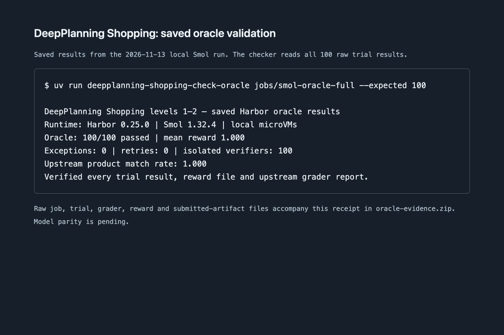

# Oracle validation

Run on 2026-11-13 with Harbor 0.25.0, smolmachines 1.32.4 and local Apple Silicon microVMs. The full job completed 100 trials with mean reward 1.0, zero exceptions, zero retries and 100 separate verifiers. Aggregate product match rate was 1.0. No inference API was used.

`oracle-evidence.zip` contains the job result, each trial's result, upstream grader report, reward, oracle output and submitted artifacts, plus generated task provenance. It also contains the negative-control job, its replacement oracle and the runtime-upgrade receipt. Extract it and verify the full job:

```bash
unzip validation/oracle-evidence.zip -d /tmp/shopping-oracle-evidence
uv run deepplanning-shopping-check-oracle /tmp/shopping-oracle-evidence/smol-oracle-full --expected 100
```

`oracle-summary.json` records all 100 task rewards. Reproduce the run with the generation and local Smol oracle commands in the adapter README. The checker validates trial counts, errors, retries, unique names, separate verification, reward files and upstream grader reports.



The negative control leaves the cart empty, writes a final message, asserts hidden tests/reference answers are absent from the agent VM, and attempts to forge `/logs/verifier/reward.txt` with a value of 1. The separate verifier produced **reward 0**, with zero exceptions. Reproduce using a copy of any generated task and replace its `solution/solve.sh` with `negative-control.sh`. Run that copy with `harbor run -p <control-dataset> -a oracle -e smol --ek target=local --ek auto_checkpoint=false`. Inspect its saved verifier report; the perfect-oracle checker intentionally rejects a zero reward.

`upstream-case36.patch` changes one phrase in the pinned Qwen-Agent metadata to match the released dataset query and size-44 reference products. Apply with `git apply` from the Qwen-Agent repository root for original-side comparisons.

Model parity is pending. These artifacts document oracle execution and verifier isolation.
