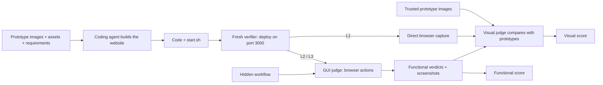

# Vision2Web Adapter

## Overview

**WIP / draft.** This adapter targets all **193 Vision2Web projects**: 100 static pages, 66 interactive frontends and 27 full-stack websites. One project becomes one Harbor task; its workflows are internal verification steps.

The generator, task templates, ARM browser environment and two-judge entrypoint are implemented. Three real projects have been generated locally. Deployment and screenshot checks use no models; **oracle scores, live judge validation and model parity are pending**.

Sources: [benchmark](https://github.com/zai-org/Vision2Web/tree/d80a4a3d0ea7326541ad87314294269a633789e4), [task data](https://huggingface.co/datasets/zai-org/Vision2Web/tree/8f03299d92b9bd852e93852d0c21e8a4848ab661), [paper](https://arxiv.org/abs/2603.26648).

## What is Vision2Web?

A coding agent receives a visual brief, implements a website, and delivers code plus `/workspace/start.sh`. Evaluation restarts that website in a fresh environment at `http://localhost:3000`.

Think of L1 as turning a design board into a responsive page; L2 makes the pages clickable; L3 makes the business behind those clicks work.

| Level | Input to the coding agent | Expected output | Verification |
|---|---|---|---|
| **L1 · 100 static pages** | Desktop, tablet and mobile prototype images; supplied assets | A runnable responsive page | Browser captures each prescribed viewport; a visual model compares it with the prototype |
| **L2 · 66 interactive frontends** | Multiple prototypes, assets and `prompt.txt` | Connected pages and working UI interactions; mock data is allowed upstream | GUI agent follows workflows; visual model compares captured page states |
| **L3 · 27 full-stack websites** | Prototypes, assets and `prd.md` | A working frontend, backend and initialized data, reproducible from `start.sh` | The same two judges inspect business workflows and visual fidelity |

For example, **RecipeCloud** asks for a responsive account page. **Anomali** adds navigation among product and resource pages. **Film Movement** adds a film/DVD catalog with backend data and state. There are 918 prototype images and 1,255 scored functional cases across the benchmark.



**Two judging roles are separate from the coding model.** Upstream defaults are:

| Role | Default model / tool | Recorded settings |
|---|---|---|
| GUI / functional judge | `claude-sonnet-4-5-20250929` through Claude Code + Playwright CLI | Claude Code 2.1.221; high effort; 64,000 output-token limit; 200,000-token compaction-window setting |
| Visual judge | `gemini-3-pro-preview` through an OpenAI-compatible endpoint | 64,000 max output tokens; temperature, top-p and seed are not explicitly set by the visual call |

The GUI judge reports Pass/Fail/Blocked for workflow validations. The visual judge divides each page into blocks and assigns 0, 0.25, 0.5, 0.75 or 1 with reasons. This measures resemblance to a supplied design, but model judgments can vary.

Within each level, upstream pools per-prototype visual scores and scored functional cases. L1 uses visual score; L2/L3 average visual and functional scores; Overall averages the three levels equally. **A flat mean of Harbor task rewards is not the official Overall.** Raw denominators are retained for `tools/aggregate.py`.

## Adapter Features

- Pinned 193-project catalog, dataset archive SHA-256 checks and upstream Python-file hashes.
- Stable task names, full/level/pilot selections and required CLI selectors.
- Byte-identical upstream coding instructions. Workflows and trusted prototypes stay in the separate verifier.
- Original functional prompt generation, VLM comparison and result analysis are reused from the verified upstream snapshot.
- ARM64 uses Playwright Chromium; amd64 retains the upstream Google Chrome installation.
- Optional reference candidates are evaluated normally; there is no oracle reward shortcut.
- Explicit model-grading opt-in. Capture-only mode writes diagnostics and **no reward**.

The verifier adapts container-local execution and output paths. Websites run as an unprivileged user without judge credentials; GUI/VLM processes and evidence use protected verifier paths. These runtime changes must also be used on the original side of the proposed parity baseline.

## Generated Task Structure

```text
vision2web-website-filmmovement/
├── task.toml
├── instruction.md
├── provenance.json
├── environment/
│   ├── Dockerfile
│   └── input/                 # prototypes, resources, PRD or prompt
├── solution/
│   ├── solve.sh
│   └── reference/             # optional candidate website
└── tests/
    ├── Dockerfile
    ├── test.sh
    ├── verify.py
    ├── metrics.py
    ├── task.json
    ├── data/                  # hidden workflow + trusted prototypes
    └── upstream/              # verified upstream Python source
```

Missing reference candidates fail explicitly. A supplied candidate is not automatically a validated oracle.

## Run Evaluation / Harness

**Registry publication is pending.** After registration, the intended dataset name is `zai-org/vision2web`. Use local paths for this draft.

From the repository root, build the runtime once:

```bash
docker build -t vision2web-sandbox:d80a4a3-arm64-browser -f src/vision2web/docker/Dockerfile src/vision2web/docker
harbor run -c src/vision2web/run_vision2web.yaml
```

The reference YAML defaults to the oracle agent. Oracle runs still invoke the real judge pipeline and need reviewed references plus API access.

Before an approved model run, set `VISION2WEB_ENABLE_MODEL_GRADING=1` and provide:

- `VISION2WEB_FUNCTIONAL_API_KEY`, optionally `VISION2WEB_FUNCTIONAL_BASE_URL`; required for L2/L3.
- `VISION2WEB_VISUAL_API_KEY` and `VISION2WEB_VISUAL_BASE_URL`; required for all levels.
- Optional `VISION2WEB_FUNCTIONAL_MODEL` / `VISION2WEB_VISUAL_MODEL` overrides agreed with the team.

A Gemini model name needs an appropriate OpenAI-compatible endpoint; the name alone does not configure one. Keep keys in runtime environment variables, never committed files.

For a no-model deployment/capture diagnostic of a generated task with a candidate:

```bash
cd src/vision2web
uv run python tools/capture.py /path/to/generated/task --output-dir /tmp/vision2web-capture
```

This captures only initial visual nodes that do not require GUI actions. It does not simulate missing workflow steps, call a judge or produce a benchmark reward.

## Usage: Create Task Directories

```bash
cd src/vision2web
uv sync --group dev
uv run vision2web --list
uv run vision2web --download --output-dir ../../datasets/vision2web
```

The full archives total about 4.11 GB compressed. Parquet previews alone are insufficient. To use an existing extracted dataset and checkout:

```bash
uv run vision2web --dataset-dir /path/to/datasets --upstream-dir /path/to/Vision2Web --split pilot --output-dir /tmp/vision2web-pilot
```

Inputs must be arranged as `<dataset-dir>/<webpage|frontend|website>/<task>/`. `--reference-dir` accepts candidate exports using the same layout. Other flags: `--task-ids`, `--limit`, `--overwrite`, `--split full|webpage|frontend|website|pilot`, `--runtime-image` and `--memory-mb`.

The pilot is RecipeCloud, Anomali and Film Movement, selected before judging. Full delivery remains 193 tasks. Generation has been exercised on these three real projects; complete archive download/full-generation validation is pending.

## Comparison with Original Benchmark (Parity)

**No model parity has been run.** `parity_experiment.json` is intentionally absent until measured results exist.

| Agent | Model | Metric | Number of Runs | Dataset Size | Original Performance | Harbor Performance |
|---|---|---|---|---|---|---|
| Pending team review | Pending team review | Visual / functional / Overall | 0 | 193 targeted; 0 parity tasks | Not run | Not run |

Local evidence is described in [validation/README.md](validation/README.md): three public candidate websites deployed on ARM and 16 direct page/viewport observations were captured. The first Film Movement candidate failed due to missing source modules; the alternative deployed successfully. These observations are not oracle passes.

Proposed sequence, subject to team review:

1. Confirm reference/oracle acceptance and API access for both judges.
2. Regrade the same frozen candidate on the pinned original harness and Harbor, using the same ARM runtime, judge models, prompts and settings.
3. Run 5–10 matched coding-agent sanity tasks, then one complete run per side over the agreed range, then three runs per side.
4. Preserve visual/functional numerators and denominators, failures, trajectories, screenshots and costs; report raw run arrays, mean ± sample SEM and the required range-overlap check.

The proposed original-side commands are the pinned upstream `vision2web evaluate` / `vision2web analyze` commands with identical judge settings. Reproduction of our verifier UID/output-path isolation on that side is still to be completed and reviewed. Model selection, run count, budget and any parity subset are not yet approved.

Current reproducible local checks, without models:

```bash
cd src/vision2web
VISION2WEB_TEST_UPSTREAM=/path/to/Vision2Web VISION2WEB_TEST_DATA=/path/to/datasets uv run pytest -q
uv run python tools/capture.py /path/to/generated/task --output-dir /tmp/vision2web-capture
```

These commands validate generation and capture plumbing only; matched model-run reproduction commands will accompany the measured parity results.

## Notes & Caveats

- **Oracle acceptance is unresolved.** Public generated implementations are candidates, not gold solutions. Continuous VLM scoring does not guarantee reference reward 1. Request team guidance; no scoring bypass is implemented.
- **Model costs remain pending.** L1 needs visual judging; L2/L3 need GUI and visual judging, including when validating a reference. All recorded local checks used zero model calls.
- **Known candidate defects:** RecipeCloud adds CAPTCHA/cookie UI absent from its prototype. Anomali's scroll-reveal blocks are hidden in an initial full-page screenshot. A Film Movement submission omits `src/data` and fails seeding. Raw observations are retained rather than presented as quality scores.
- **ARM evidence is limited.** A controlled fixed-site experiment matched 18 image pairs across native ARM and locally emulated amd64, and a separate Harbor plumbing fixture matched six image pairs. This is not live-model parity or a native x86 performance test.
- **Runtime limits are provisional.** The generator defaults to an 8 GiB cap and 36,000-second agent/verifier limits. The upstream 64 GiB cap is not a measured minimum. Record and match resource limits before parity.
- **Dependency pins need completion.** Upstream runtime installation still contains floating dependencies; record image digests and CLI/browser/font versions for formal runs. Node 20 also differs from the declared Node requirement of the pinned Claude package; version commands worked, but live inference is untested.
- **Publication is pending.** Upstream license labels differ between its dataset header and README. No generated datasets, website implementations or prototype images are included in this adapter PR; clarify terms before redistribution/registration.

## Installation / Prerequisites

Python 3.12+, uv, Git and Docker. The adapter is an independent uv project. Task generation uses the standard library; generated verifiers install the SDK dependencies in their own image.

```bash
uv run pytest -q
VISION2WEB_TEST_UPSTREAM=/path/to/Vision2Web VISION2WEB_TEST_DATA=/path/to/datasets uv run pytest -q
uv run ruff check src tests tools
```

The second command enables real-input generation checks. The plain test suite skips that integration check when source/data paths are absent.

## Troubleshooting

- **Missing task data:** use the complete pinned archives, not metadata previews.
- **Upstream source mismatch:** use the exact revision; the generator checks Python-file hashes.
- **Missing browser on ARM:** rebuild the provided runtime and inspect the Playwright global executable configuration.
- **No reference candidate:** `solve.sh` fails until `--reference-dir` supplies one.
- **Model grading disabled / missing judge key:** expected in this draft; coordinate access before enabling it.
- **No reward from capture-only:** intentional. Inspect `capture.json` and screenshots.
- **Harbor local image removed between trials:** the reference YAML uses `delete: false` to preserve images with the locally tested Harbor runtime.

## Citation

```bibtex
@misc{he2026vision2webhierarchicalbenchmarkvisual,
  title={Vision2Web: A Hierarchical Benchmark for Visual Website Development with Agent Verification},
  author={Zehai He and Wenyi Hong and Zhen Yang and Ziyang Pan and Mingdao Liu and Xiaotao Gu and Jie Tang},
  year={2026},
  eprint={2603.26648},
  archivePrefix={arXiv}
}
```

## Authors & Contributions

Benchmark: the Vision2Web authors at Z.ai. Adapter: Shuting Zhao (`stzoozz`).

The source benchmark, grading prompts, public candidate implementations and datasets retain their original attribution. This draft contributes Harbor packaging, generation, ARM browser configuration and local validation.
